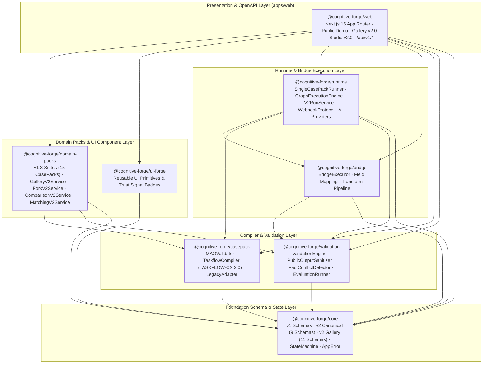
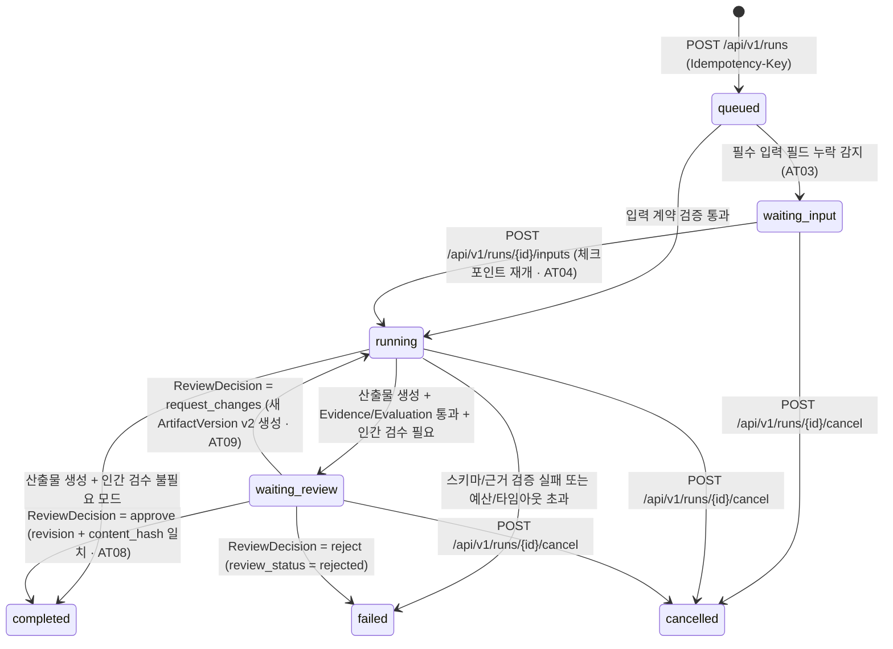
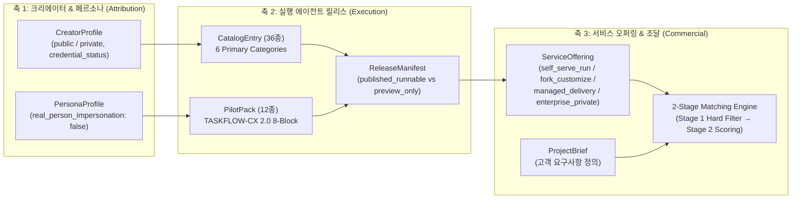

# 01. 시스템 아키텍처 명세서 (System Architecture Specification)

본 문서는 **Cognitive Forge OS (v1 Suites + v2.0 Core & Gallery Edition)**의 전체 모노레포 패키지 구조, 계층형 의존성 아키텍처, Core v2.0 상태 머신, Gallery v2.0 3축 분리 아키텍처, 데이터 스키마 및 보안 경계를 정의합니다.

---

## 1. 아키텍처 설계 원칙 (Core Architectural Principles)

1. **계약 기반 실행 (Contract-First Execution)**:
   - 모든 에이전트는 단순 프롬프트가 아니라, 입출력 스키마·검증 규칙·근거 인용 정책·도구 권한·폴백 정책이 명시된 정식 실행 계약(`CasePackMAO` 및 `TASKFLOW-CX 2.0` 8-Block `CasePackDefinition`)으로 정의됩니다.
2. **릴리스 불변성 및 고정 (Release Pinning & Immutability)**:
   - 모든 실행(`RunReceipt`)은 시작 시점의 불변 `ReleaseManifest`(`release_id` + `content_hash`)에 고정되며, 실행 도중 새 릴리스가 배포되더라도 진행 중인 실행과 검수 이력은 원래 릴리스 스냅샷을 유지합니다(`AT05`, `GT14`).
3. **근거 고정 및 인간 검수 (Evidence-Pinned & Human-in-the-Loop)**:
   - 산출물의 모든 버전(`ArtifactVersion`)은 원문 출처(`source_id`, `locator`, `excerpt_hash`)를 인용하며, 숫자·날짜·주체 왜곡을 감지하는 `FactConflictDetector`와 인간 검수 게이트(`ReviewDecision`: `approve` / `request_changes` / `reject`)를 통과해야 최종 승인됩니다(`AT06`~`AT09`).
4. **3축 분리 갤러리 아키텍처 (3-Axis Gallery Separation)**:
   - 에이전트 갤러리는 **누가 만들었는가(`CreatorProfile` / `PersonaProfile`)**, **무엇이 실행되는가(`CasePackRelease` / `PilotPack`)**, **어떤 방식으로 제공·계약되는가(`ServiceOffering`)**의 3축을 엄격히 분리합니다(`D20`).
5. **공개 표면 IP 비노출 (Zero Internal IP Leakage)**:
   - 모든 공개 API(`/api/public/*`, `/api/v1/gallery/*`) 응답은 `PublicOutputSanitizer` 및 `deepSanitize`를 거쳐 `casepack_json`, `taskflow_cx`, `K_REF`, `runtime_contract`, `execution_plan`, `trace_payload` 등 내부 실행 자산을 100% 제거합니다.

---

## 2. 모노레포 패키지 계층 구조 (Monorepo Layered Architecture)

워크스페이스는 `pnpm` 모노레포 기반의 7개 도메인 패키지(`packages/*`)와 1개 Next.js 15 웹 애플리케이션(`apps/web`)으로 구성됩니다.

### 패키지별 핵심 책임 및 주요 모듈

| 패키지 | 경로 | 주요 모듈 | 핵심 역할 |
| :--- | :--- | :--- | :--- |
| `@cognitive-forge/core` | `packages/core` | `schemas/v2-canonical.ts`, `schemas/v2-gallery.ts`, `state/state-machine.ts`, `types/error.ts` | 전사 공통 타입, v1 MAO/Bridge/Graph 스키마, Core v2.0 9대 정본 스키마, Gallery v2.0 11대 스키마, Run 상태 머신 및 낙관적 동시성(`expected_revision`) 검증 |
| `@cognitive-forge/casepack` | `packages/casepack` | `compiler/taskflow-compiler.ts`, `compiler/legacy-adapter.ts`, `validator/mao-validator.ts` | v1 CasePack → v2.0 무손실 변환 어댑터(`T02`), `TASKFLOW-CX 2.0` 8-Block 컴파일러 및 필수 실패/검증 규칙·미지원 도구 차단 게이트(`T03`) |
| `@cognitive-forge/validation` | `packages/validation` | `sanitizer/public-output-sanitizer.ts`, `evidence/fact-conflict-detector.ts`, `evaluation/evaluation-runner.ts` | 공개 응답 내 내부 IP 키(`FORBIDDEN_PUBLIC_KEYS`) 완전 제거, 원문 대비 인용·숫자·날짜·주체 불일치 감지(`T05`), 벤치마크 평가 및 릴리스 적격성 판정(`T07`) |
| `@cognitive-forge/bridge` | `packages/bridge` | `executor/bridge-executor.ts`, `validator/bridge-validator.ts` | 다중 에이전트 순차 그래프 실행 시 선행 CasePack 산출물을 후행 CasePack 입력 계약으로 안전하게 매핑·변환 |
| `@cognitive-forge/runtime` | `packages/runtime` | `runner/single-casepack-runner.ts`, `graph/graph-execution-engine.ts`, `service/run-service.ts`, `webhook/webhook-protocol.ts` | v1 단일/그래프 실행 엔진, Core v2.0 `V2RunService`(멱등성·체크포인트 재개·인간 검수·취소), OpenAI/Anthropic/Gemini/Mock 어댑터, HMAC-SHA256 웹훅 프로토콜(`T08`) |
| `@cognitive-forge/domain-packs` | `packages/domain-packs` | `gallery/catalog-loader.ts`, `gallery/gallery-service.ts`, `gallery/fork-service.ts`, `gallery/comparison-service.ts`, `gallery/matching-service.ts` | v1 3대 도메인 스위트(Corporate PR, Book-to-Agent, AI Training) 및 Gallery v2.0 36종 카탈로그, 12종 파일럿 팩, 포크 계보, A/B 비교 실험실, 2-Stage 매칭 엔진 |
| `@cognitive-forge/ui-forge` | `packages/ui-forge` | `src/index.ts` | 공통 디자인 토큰 및 신뢰 배지 컴포넌트 |
| `@cognitive-forge/web` | `apps/web` | `app/api/v1/*`, `app/gallery/*`, `app/studio/*`, `app/compare/*`, `app/projects/*`, `app/demo/*` | Next.js 15 기반 Public Web, Gallery v2.0 UI, Studio v2.0 콘솔, Core/Gallery OpenAPI v1 라우트 핸들러 |

---

## 3. Core v2.0 실행 상태 머신 및 검수 아키텍처 (`D04`, `T04`, `T06`)

Core v2.0의 모든 실행(`RunReceipt`)은 7개 정규 상태(`queued`, `running`, `waiting_input`, `waiting_review`, `completed`, `failed`, `cancelled`)와 결정론적 상태 전이 규칙을 따르며, 모든 상태 변경 요청은 `expected_revision` 낙관적 잠금(CAS)을 검증합니다.

### 상태 전이 불변 규칙 (Invariants)
- **종단 상태 재전이 금지**: `completed`, `failed`, `cancelled` 상태에 도달한 실행은 어떠한 후속 입력이나 검수 결정으로도 상태를 되돌릴 수 없으며 즉시 `409 CONFLICT`를 반환합니다.
- **스테일 리비전(Stale Revision) 차단**: 클라이언트가 제출한 `expected_revision`이 현재 `RunReceipt.revision`과 일치하지 않으면 `409 CONFLICT`로 거부됩니다(`AT08`, `AT14`).
- **산출물 해시 무결성 검증**: `POST /api/v1/runs/{run_id}/decisions` 호출 시 검수자가 확인한 `artifact_version`과 `content_hash`가 서버의 최신 산출물 버전과 다르면 승인을 거부합니다.

---

## 4. Gallery v2.0 3축 분리 및 실행/매칭 아키텍처 (`D18`~`D26`)

Gallery Edition v2.0은 에이전트 마켓플레이스와 엔터프라이즈 조달 워크플로를 단일 플랫폼 안에서 완결하기 위해 다음 아키텍처를 채택합니다.

### 핵심 거버넌스 메커니즘
1. **`published_runnable` (12종) vs `preview_only` (24종) 엄격 분리 (`GT01`, `GT06`)**:
   - 공인 벤치마크 3종(`normal`, `missing_input`, `adversarial`)을 모두 통과하여 `evaluation_status = pass`를 획득한 12종 파일럿 팩만 실시간 실행(`published_runnable`)이 활성화됩니다.
   - 나머지 24종 `preview_only` 리스팅은 카탈로그 탐색과 사양 열람만 허용하며, 실행 API 호출 시 `422 UNPROCESSABLE_ENTITY`로 즉시 차단됩니다.
2. **안전한 포크 계보 및 격리 (`ForkV2Service` — `GT03`~`GT05`)**:
   - `fork_policy = open`인 릴리스만 포크할 수 있으며(`prohibited`는 `403 FORBIDDEN`), 포크 생성 시 항상 호출자 워크스페이스의 비공개 초안(`draft`)으로 생성됩니다.
   - 원본의 고객 데이터·실행 로그·비밀키는 절대 복제되지 않으며(`copied_customer_data = false`), 부모 릴리스의 검증 배지 역시 상속되지 않습니다(`inherited_verified_badge = false`).
3. **Side-by-Side 벤치마크 A/B 비교 실험실 (`ComparisonV2Service` — `GT07`, `GT08`, `GT13`)**:
   - 동일 `BenchmarkTask`에 대해 2~3개의 릴리스를 병렬 실행하고, 후보 간 모델명이나 `temperature` 차이가 존재하면 순수 페르소나 비교가 아님을 명시하는 설정 차이 배너(`diff_warnings`)를 노출합니다.
   - `owner_private` 데이터 범위는 수신자 동의 헤더(`X-Recipient-Consent: true`) 없이는 전송을 차단(`403 FORBIDDEN`)하며, 일부 후보만 실패한 경우 성공한 후보를 재과금하지 않고 실패한 후보만 선택 재시도합니다.

---

## 5. 데이터베이스 및 멀티테넌트 보안 아키텍처 (`supabase/migrations/`)

총 13개의 순차 SQL 마이그레이션(`20260501000001_enums_and_extensions.sql` ~ `20260502000013_gallery_v2_tables.sql`)을 통해 v1 테이블과 v2.0 Core/Gallery 정본 테이블 및 PostgreSQL Row-Level Security(RLS) 정책이 구성됩니다.

| 마이그레이션 파일 | 계층 | 주요 생성 테이블 및 정책 |
| :--- | :--- | :--- |
| `00001` ~ `00011` | v1 Foundation & Suites | `workspaces`, `workspace_members`, `casepacks`, `casepack_versions`, `bridges`, `graphs`, `graph_versions`, `apps`, `runs`, `graph_runs`, `validation_reports`, `telemetry_events`, `usage_ledger` |
| `20260502000012_v2_core_canonical_tables.sql` | Core v2.0 Canonical | `v2_agent_applications`, `v2_casepack_definitions`, `v2_release_manifests`, `v2_work_requests`, `v2_run_receipts`, `v2_artifact_versions`, `v2_review_decisions`, `v2_evaluation_reports`, `v2_event_outbox` + 워크스페이스 격리 RLS |
| `20260502000013_gallery_v2_tables.sql` | Gallery v2.0 Edition | `v2_creator_profiles`, `v2_persona_profiles`, `v2_catalog_entries`, `v2_pilot_packs`, `v2_gallery_listings`, `v2_service_offerings`, `v2_fork_lineages`, `v2_benchmark_tasks`, `v2_comparison_sessions`, `v2_project_briefs`, `v2_match_candidates` + 공개 카탈로그 조회 및 테넌트 격리 RLS |
