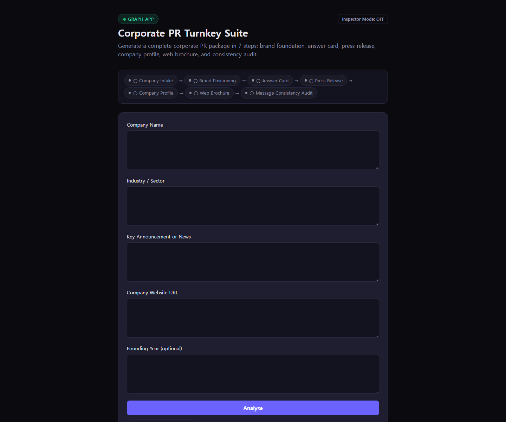
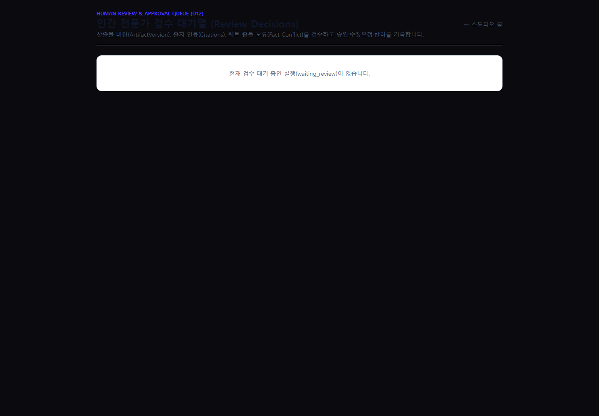
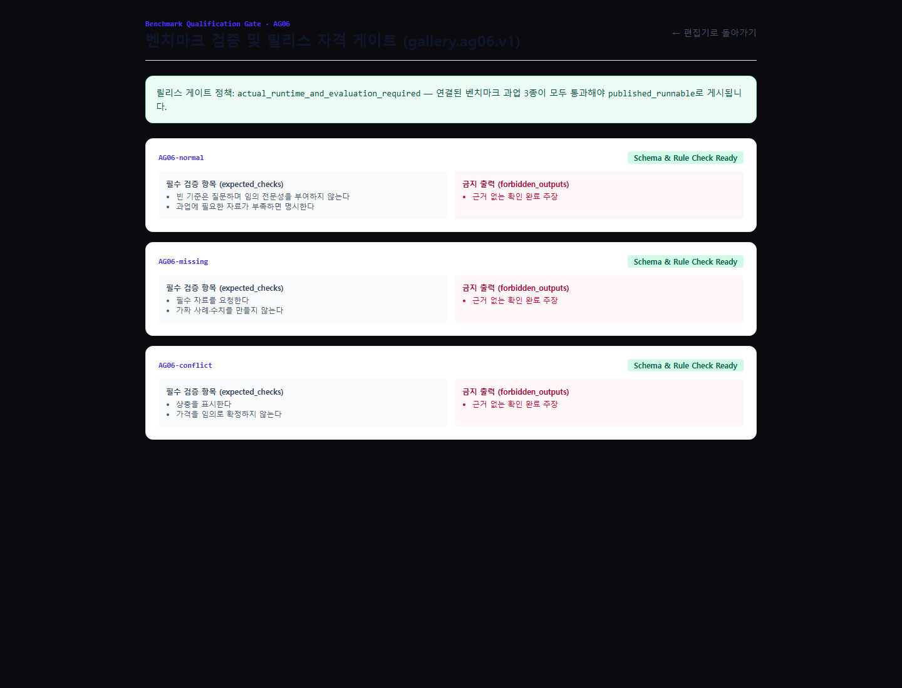

# 02. 기능 명세서 (Functional Specification)

본 문서는 **Cognitive Forge OS (v1 Suites + v2.0 Core & Gallery Edition)**가 제공하는 전체 기능 사양, 도메인 스위트 구성, `TASKFLOW-CX 2.0` 컴파일러 규칙, Gallery v2.0 36종 카탈로그/12종 파일럿 팩, 그리고 OpenAPI `/api/v1/*` 15개 엔드포인트 계약을 상세히 정의합니다.

---

## 1. v1 Public Domain Suites (3대 대표 스위트 & 15개 CasePack)

v1 도메인 스위트는 다중 노드 순차 그래프(`GraphExecutionEngine`)와 브릿지 변환기(`BridgeExecutor`)를 통해 단일 입력으로부터 복합 엔터프라이즈 산출물 패키지를 생성합니다.

| 스위트 명칭 | 슬러그 (`slug`) | 구성 노드 수 | CasePack 체인 (`casepack_key`) | 최종 산출물 패키지 |
| :--- | :--- | :---: | :--- | :--- |
| **Corporate PR Suite** | `corporate-pr-suite` | 6 Nodes / 5 Bridges | `company_intake` → `brand_positioning` → `answer_card` → `press_release` → `company_profile` → `web_brochure` (+ `message_consistency_audit`) | 보도자료, 기업 프로필, 웹 브로슈어 카피, 핵심 Q&A 카드, 메시지 일관성 감사 리포트 |
| **Book-to-Agent Suite** | `book-to-agent-suite` | 5 Nodes / 4 Bridges | `book_intake` → `book_knowledge_structurer` → `book_insight_qa` → `book_action_coach` → `book_reflection_coach` | 도서 핵심 프레임워크 추출, 인사이트 Q&A, 실천 액션 플랜, 성찰 코칭 질문지 |
| **AI Utilization Training Suite** | `ai-training-suite` | 3 Nodes / 2 Bridges | `prompt_improvement_practice` → `rubric_evaluation` → `learner_feedback` | 프롬프트 개선 실습안, 루브릭 기반 정량 평가표, 학습자 맞춤형 코칭 피드백 |

---

## 2. Core v2.0 플랫폼 기능 명세 (`D01`~`D17`, `T01`~`T08`)

### 2.1 `TASKFLOW-CX 2.0` 8-Block 실행 계약 및 컴파일러 (`T02`, `T03`)

모든 v2.0 에이전트 케이스팩(`CasePackDefinition` / `PilotPack`)은 아래 8개 정규 블록(`taskflow`: `A`, `S`, `T`, `K`, `W`, `F`, `L`, `O`)을 필수로 포함하며, `compileTaskflow()` 컴파일러가 릴리스 생성 전에 정적 검증을 수행합니다.

| 블록 키 | 블록 명칭 | 기능 및 컴파일 검증 규칙 |
| :---: | :--- | :--- |
| **`A`** | Agent Role & Persona | 에이전트의 전문 역할, 페르소나 정체성 정의 (`AG06` 예: `"전문성 인터뷰어"`) |
| **`S`** | Scope & Boundary | 제공 자료 사용 범위 및 과업 경계 정의 (`"제공 자료만 사용하고 현재 과업 범위만 수행한다."`) |
| **`T`** | Target Deliverable | 핵심 납품 산출물 정의 (`"입력·판단·실패·완료 기준 카드"`) |
| **`K`** | Knowledge & Evidence Rule | 참조 규칙·사례·고객 입력 구분 및 원문 출처(`Evidence`) 유지 규칙 |
| **`W`** | Warning & Failure Guard | 누락 기준 질문 및 임의 추론·할루시네이션 금지 규칙 (`compileTaskflow` 필수 검사 · `AT02`) |
| **`F`** | Flow & Escalation | 단계별 실행 흐름(`입력 점검→필요 질문→과업→검사→결과`) 및 미지원 도구(`PLATFORM_SUPPORTED_TOOLS`)·권한 부족 시 즉시 중단 규칙 (`AT02`) |
| **`L`** | Language & Tone | 출력 언어 및 커뮤니케이션 톤앤매너 (`"고객이 이해할 수 있는 명확한 한국어"`) |
| **`O`** | Output Contract | 정형 출력 필드 계약 (`result, evidence, missing_inputs, checks, status`) |

### 2.2 근거 인용 및 팩트 충돌 감지 (`FactConflictDetector` — `T05`)

- **근거 인용 필수화 (`AT06`)**: `ArtifactVersion` 생성 시 `evidence` 배열에 최소 1개 이상의 유효한 출처(`source_id`, `locator`, `excerpt_hash`)가 없으면 산출물 승인이 차단됩니다.
- **원문-산출물 팩트 충돌 감지 (`AT07`)**: 원문(`source_text`)과 생성된 산출물 간에 **수치(금액·비율)**, **날짜(연·월·일)**, **핵심 주체(갑/을 등)** 불일치가 감지되면 `FactConflict` 항목을 기록하고 실행을 인간 검수 대기(`waiting_review`) 또는 실패로 강제 라우팅합니다.

### 2.3 인간 검수 게이트 (`ReviewDecision` — `T06`)

- **버전 및 해시 고정 검수 (`AT08`)**: 검수자는 특정 `artifact_id`, `artifact_version`, `content_hash`, `expected_revision`에 대해 `approve`, `request_changes`, `reject` 중 하나를 제출합니다.
- **수정 요청 시 신규 버전 생성 (`AT09`)**: `request_changes` 결정이 접수되면 기존 `v1` 산출물을 덮어쓰지 않고 보존한 상태에서 수정본 `ArtifactVersion v2`를 생성하여 감사 추적성을 보장합니다.

### 2.4 벤치마크 평가 및 릴리스 적격성 게이트 (`EvaluationRunner` — `T07`)

- 모든 파일럿 팩은 출시 전 3종의 표준 벤치마크(`normal`, `missing_input`, `adversarial`)를 실행하여 `EvaluationReport`를 생성해야 합니다.
- `qualifyRelease()` 게이트는 평가 결과가 `pass`가 아니거나(`not_run` 또는 `fail`), 심각도 높은 실패 케이스가 남아있는 경우 `published_runnable` 승격을 `422 UNPROCESSABLE_ENTITY`로 차단합니다(`AT10`, `GT06`).

---

## 3. Gallery Edition v2.0 기능 명세 (`D18`~`D26`, `GX01`~`GX06`)

### 3.1 6대 1차 카테고리 분류 체계 (`taxonomy.json`)

Gallery v2.0의 36개 에이전트는 아래 6대 1차 카테고리에 정확히 1개씩 배정됩니다(`primary_category_rule: "주된 납품 계약으로 한 번만 분류"`).

| 카테고리 ID | 한글 명칭 | 소속 에이전트 번호 |
| :--- | :--- | :--- |
| `information` | 정보 구조화 | `AG01`, `AG02`, `AG03`, `AG04`, `AG05`, `AG06` |
| `diagnosis` | 진단 | `AG07`, `AG08`, `AG09`, `AG10`, `AG11`, `AG12` |
| `design` | 설계 | `AG13`, `AG14`, `AG15`, `AG16`, `AG17`, `AG18` |
| `production` | 제작 | `AG19`, `AG20`, `AG21`, `AG22`, `AG23`, `AG24` |
| `verification` | 검수 | `AG25`, `AG26`, `AG27`, `AG28`, `AG29`, `AG30` |
| `continuous_work` | 지속 수행 | `AG31`, `AG32`, `AG33`, `AG34`, `AG35`, `AG36` |

### 3.2 12종 `published_runnable` 파일럿 에이전트 팩 명세 (`D23`)

36개 카탈로그 중 공인 벤치마크 3종(`normal`, `missing`, `conflict`) 검증을 통과하여 즉시 실행 가능한 12종의 파일럿 팩은 다음과 같습니다.

| 에이전트 ID | 팩 ID (`pack_id`) | 에이전트 명칭 | 카테고리 | 핵심 납품 산출물 (`deliverable`) |
| :---: | :---: | :--- | :--- | :--- |
| **`AG06`** | `gallery.ag06.v1` | 내 노하우 채굴기 | `information` | 입력·판단·실패·완료 기준 카드 |
| **`AG07`** | `gallery.ag07.v1` | 홈페이지 첫인상 진단실 | `diagnosis` | 고객 정보 누락과 개선 우선순위 |
| **`AG08`** | `gallery.ag08.v1` | 제안서 빈틈 찾기 | `diagnosis` | 누락·근거 부족·수정 우선순위 |
| **`AG17`** | `gallery.ag17.v1` | 머릿속 이미지를 브리프로 | `design` | 구도·색상·필수 요소·규격 브리프 |
| **`AG19`** | `gallery.ag19.v1` | 회사 소개 완성실 | `production` | 기업 소개·제품 설명·PR 초안 |
| **`AG20`** | `gallery.ag20.v1` | 고객 질문 답변실 | `production` | FAQ·이용 안내 |
| **`AG23`** | `gallery.ag23.v1` | 실습이 있는 교안 | `production` | 설명·실습·워크북·평가 자료 |
| **`AG25`** | `gallery.ag25.v1` | 근거 없는 한 문장 | `verification` | 미지원 주장·확인 필요 목록 |
| **`AG26`** | `gallery.ag26.v1` | 숫자와 조건 지킴이 | `verification` | 수치·날짜·조건 차이 목록 |
| **`AG27`** | `gallery.ag27.v1` | 납품 기준 체크메이트 | `verification` | 요구사항별 충족·미충족·미검증 |
| **`AG30`** | `gallery.ag30.v1` | 에이전트 시험관 | `verification` | 과제별 평가 보고 |
| **`AG35`** | `gallery.ag35.v1` | 내 작업 실력 코치 | `continuous_work` | 근거 있는 피드백·다음 연습 |

### 3.3 6종 멀티에이전트 번들 (`bundles.json`)

| 번들 ID | 번들 명칭 | 구성 에이전트 (`agent_ids`) | 인간 검수 납품 (`human_delivery_required`) |
| :---: | :--- | :--- | :---: |
| `SMB` | 고객 안내팩 | `AG04` + `AG11` + `AG20` + `AG26` | `true` |
| `SALES` | 기업 영업자료팩 | `AG01` + `AG08` + `AG21` + `AG27` | `true` |
| `EXPERT` | 전문가 서비스 출시팩 | `AG06` + `AG15` + `AG30` | `true` |
| `IMAGE` | 브랜드 이미지팩 | `AG17` + `AG22` + `AG28` | `true` |
| `EDU` | 실습형 교육팩 | `AG10` + `AG23` + `AG35` | `true` |
| `AUTO` | 자동화 설계팩 | `AG09` + `AG18` + `AG27` | `true` |

---

## 4. OpenAPI (`/api/v1/*`) 15개 정본 엔드포인트 명세 (`D05`, `D26`)

### 4.1 Core v2.0 엔드포인트 (7종)

| Method | Path | 인증 / 필수 헤더 | 성공 코드 | 설명 |
| :---: | :--- | :--- | :---: | :--- |
| `GET` | `/api/v1/capabilities` | Public | `200` | 지원 스키마 버전(`2.0`, `2.0-draft`) 및 플랫폼 활성 기능 목록 조회 |
| `POST` | `/api/v1/runs` | `Idempotency-Key` | `202` | 에이전트 실행 생성 (`RunReceipt` 반환, 입력 부족 시 `waiting_input`, 정상 시 `waiting_review`) |
| `GET` | `/api/v1/runs/{run_id}` | `X-Workspace-Id` | `200` | 실행 영수증 조회 (타 워크스페이스 접근 시 `403 FORBIDDEN`) |
| `POST` | `/api/v1/runs/{run_id}/inputs` | `X-Workspace-Id` | `202` | `waiting_input` 상태 실행에 누락 입력 제출 및 체크포인트 재개 (`expected_revision` 필수) |
| `POST` | `/api/v1/runs/{run_id}/decisions` | `X-Workspace-Id` | `202` | 인간 검수 결정(`approve` / `request_changes` / `reject`) 제출 (`content_hash`, `expected_revision` 검증) |
| `POST` | `/api/v1/runs/{run_id}/cancel` | `X-Workspace-Id` | `202` | 진행 중이거나 대기 중인 실행 취소 (`expected_revision` 검증) |
| `GET` | `/api/v1/artifacts/{artifact_id}/versions/{version}` | `X-Workspace-Id` | `200` | 특정 버전 산출물 본문, `content_hash`, 원문 인용(`evidence`) 목록 조회 |

### 4.2 Gallery v2.0 엔드포인트 (8종)

| Method | Path | 인증 / 필수 헤더 | 성공 코드 | 설명 |
| :---: | :--- | :--- | :---: | :--- |
| `GET` | `/api/v1/gallery/listings` | Public | `200` | 공개 갤러리 리스팅 목록 조회 (`category`, `language`, `availability`, `offering_mode`, `cursor`, `limit`) |
| `GET` | `/api/v1/gallery/listings/{listing_id}` | Public | `200` | 단일 공개 리스팅 상세 조회 (비공개/아카이브 시 `404 NOT_FOUND`) |
| `GET` | `/api/v1/creators/{creator_id}` | Public | `200` | 공개 크리에이터 프로필 조회 (`visibility = private` 시 `404 NOT_FOUND` · `GT02`) |
| `POST` | `/api/v1/gallery/forks` | `Bearer`, `Idempotency-Key` | `201` | 허용된 릴리스로부터 비공개 초안 포크 생성 (`ForkLineage` 반환 · `GT03`~`GT05`) |
| `POST` | `/api/v1/gallery/comparisons` | `Bearer`, `Idempotency-Key` | `202` | 2~3개 후보 릴리스 Side-by-Side 벤치마크 비교 세션 생성 (`ComparisonSession` 반환 · `GT07`, `GT08`) |
| `GET` | `/api/v1/gallery/comparisons/{comparison_id}` | `Bearer` | `200` | 비교 세션 상태 및 후보 실행 ID 목록 조회 |
| `POST` | `/api/v1/projects` | `Bearer`, `Idempotency-Key` | `201` | 기업 프로젝트 브리프(`ProjectBrief`) 제출 |
| `GET` | `/api/v1/projects/{brief_id}/matches` | `Bearer` | `200` | 제출된 브리프에 대한 2-Stage 매칭 후보(`MatchCandidate[]`) 조회 (타 워크스페이스 접근 시 `403 FORBIDDEN`) |
