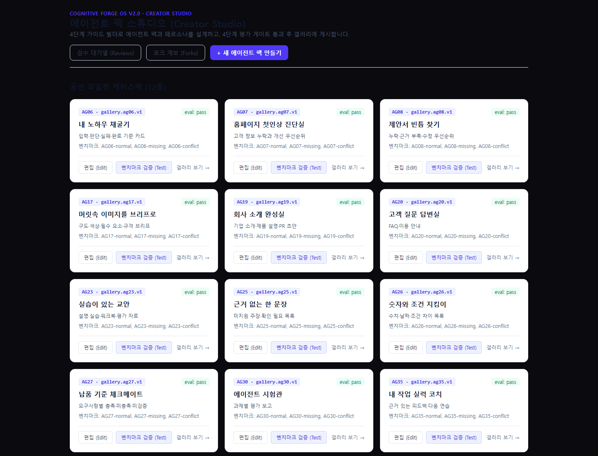
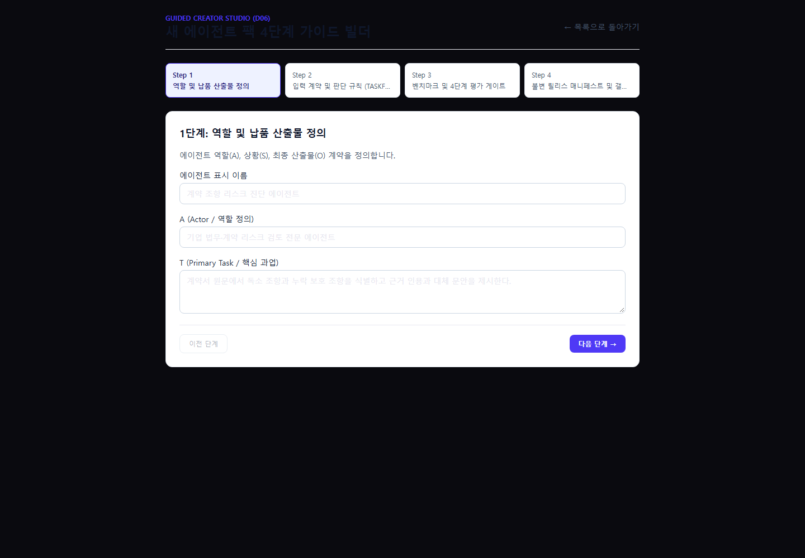
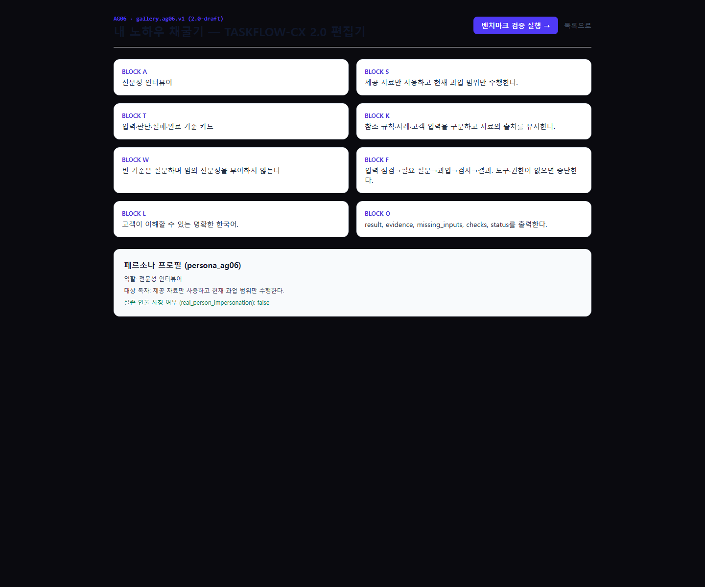
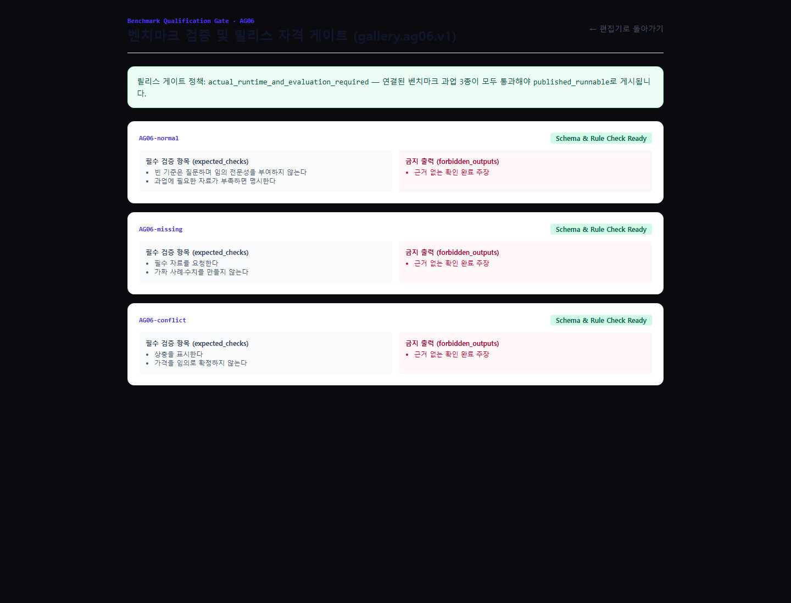
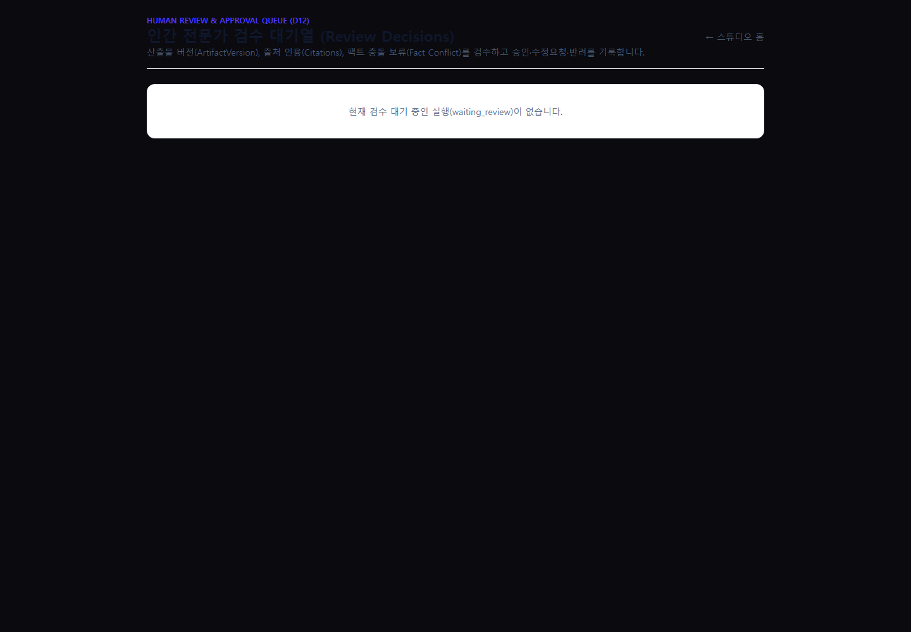
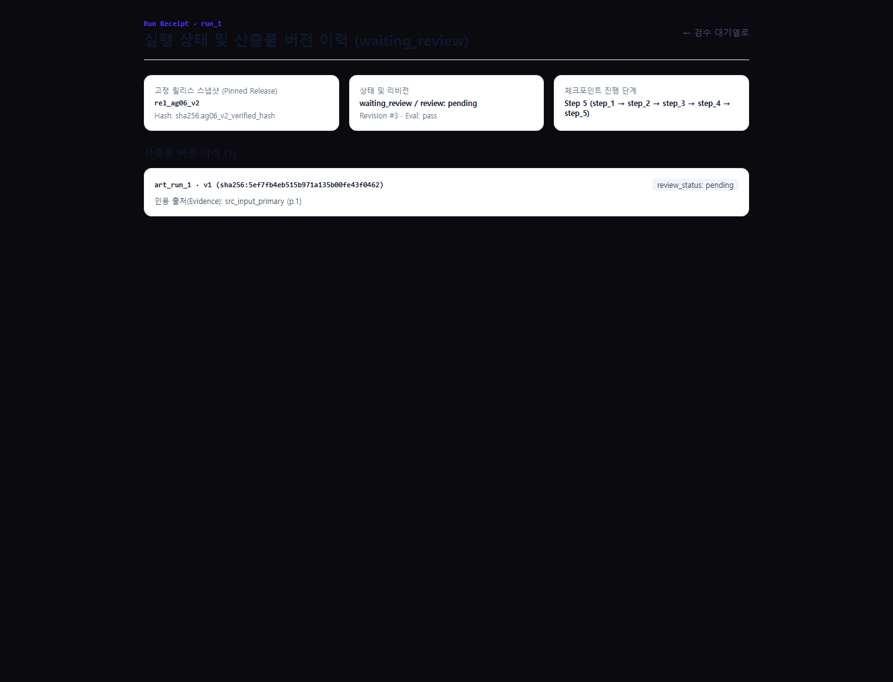
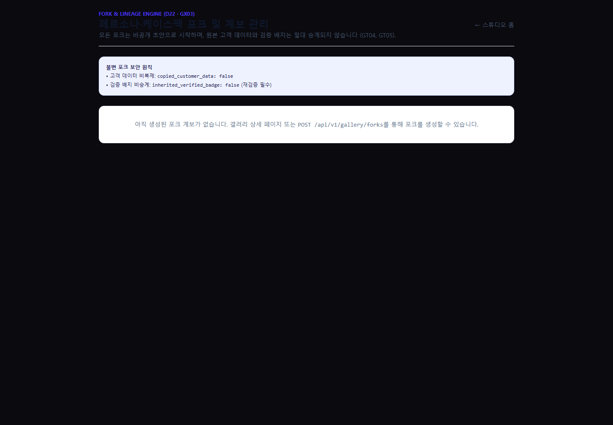

# 03. 운영자 가이드 (Operator & Administrator Guide)

본 문서는 **Cognitive Forge OS (v1 Suites + v2.0 Core & Gallery Edition)**를 배포·검증·모니터링·운영하는 데브옵스(DevOps) 엔지니어 및 플랫폼 운영자를 위한 실무 운영 매뉴얼입니다.

---

## 1. 환경 구성 및 프로덕션 배포 절차

### 1.1 필수 런타임 및 패키지 매니저 요구사항
- **Node.js**: `>= 20.x` (권장 `24.x`)
- **pnpm**: `>= 9.x` (`pnpm-workspace.yaml` 기반 모노레포 관리)
- **Supabase (선택/프로덕션 DB 연동 시)**: PostgreSQL 15+ 및 마이그레이션 `00001`~`00013`
- **Vercel CLI**: `vercel >= 50.x` (`Root Directory: apps/web`)

### 1.2 환경 변수 설정 (`.env.local` / Vercel Environment Variables)

| 변수명 | 필수 여부 | 기본값 / 예시 | 용도 설명 |
| :--- | :---: | :--- | :--- |
| `AI_PROVIDER_MODE` | 선택 | `mock` (`mock` \| `live`) | `mock` 설정 시 결정론적 `MockAIProvider`로 동작하며, `live` 설정 시 실제 LLM API 호출 |
| `OPENAI_API_KEY` | `live` 시 필수 | `sk-...` | OpenAI 어댑터(`OpenAIProvider`) 인증 키 |
| `ANTHROPIC_API_KEY` | 선택 | `sk-ant-...` | Anthropic 어댑터(`AnthropicProvider`) 인증 키 |
| `GEMINI_API_KEY` | 선택 | `AIza...` | Google Gemini 어댑터(`GeminiProvider`) 인증 키 |
| `NEXT_PUBLIC_SUPABASE_URL` | 선택 | `https://<project>.supabase.co` | Supabase 프로젝트 URL (미설정 시 인메모리 스토어 자동 폴백) |
| `SUPABASE_SERVICE_ROLE_KEY` | 선택 | `eyJ...` | 서버 전용 Supabase 서비스 롤 키 |
| `FORGE_ADMIN_API_KEY` | 권장 | `forge-admin-...` | `/api/packs`, `/api/casepacks`, `/api/graphs`, `/api/apps` 관리 API 쓰기 보호 키 |
| `FORGE_WEBHOOK_SECRET` | 권장 | `whsec_...` | 외부 웹훅 발송/수신 시 `X-Forge-Signature` HMAC-SHA256 서명 비밀키 |

### 1.3 데이터베이스 마이그레이션 적용 절차

Supabase(PostgreSQL) 환경에 스키마를 적용할 때 아래 순서대로 13개 마이그레이션이 적용됩니다:

```powershell
# Supabase CLI 사용 시
supabase db push

# 주요 마이그레이션 파일 구성:
# supabase/migrations/20260501000001_enums_and_extensions.sql ~ 20260502000011_bridges_and_graph_runs_fix.sql (v1 스키마)
# supabase/migrations/20260502000012_v2_core_canonical_tables.sql (Core v2.0 9대 정본 테이블 + RLS)
# supabase/migrations/20260502000013_gallery_v2_tables.sql (Gallery v2.0 11대 테이블 + RLS)
```

### 1.4 카탈로그 시드 및 임베디드 번들 동기화 (`pnpm seed:gallery`)

`docs/Cognitive_Forge_OS_Gallery_Repo_Docs_v2_0/gallery/` 하위의 카탈로그(`agents36.json`), 파일럿 팩(`pilot_packs/*.json`), 벤치마크(`benchmarks/tasks.json`)를 수정한 후에는 반드시 아래 명령어를 실행하여 서버리스 번들 폴백 파일(`packages/domain-packs/src/gallery/embedded-catalog.ts`)을 갱신해야 합니다:

```powershell
pnpm seed:gallery
```

---

## 2. 상용 릴리스 게이트 및 자동화 검증 명령어

배포 전·후 시스템 무결성을 검증하기 위해 아래 명령어 세트를 제공합니다.

| 명령어 | 실행 스크립트 | 검증 대상 및 합격 기준 |
| :--- | :--- | :--- |
| `pnpm typecheck` | 전 워크스페이스 `tsc --noEmit` | 8개 워크스페이스 패키지 전체 TypeScript strict 타입 에러 0건 |
| `pnpm test` | `vitest run` | 54개 테스트 파일 / 783개 단위·통합·수용(`AT01~AT18`, `GT01~GT16`)·E2E 골든 테스트 전원 통과 |
| `pnpm fixtures:validate` | `scripts/validate-fixtures.ts` | v1 15개 CasePack, 11개 Bridge, 3개 Graph, Mock Output Map 정합성 100% 통과 |
| `pnpm gallery:validate` | `scripts/validate-gallery-v2.ts` | Core v2.0(9 스키마, 18 수용케이스) + Gallery v2.0(11 스키마, 36 카탈로그, 12 파일럿팩, 36 벤치마크, 16 수용케이스) 31개 체크 통과 |
| `pnpm release:check` | `scripts/release-check.ts` | 타입체크·단위/통합/E2E 테스트·픽스처/갤러리 검증·프로덕션 빌드·No-Leak 스캔 종합 게이트 (`Commercial Readiness Score: 100%`) |
| `pnpm tsx scripts/smoke-live-production.ts` | `scripts/smoke-live-production.ts` | 프로덕션 배포 URL(`https://cognitive-forge-two.vercel.app`) 대상 19개 라이브 HTTP E2E 골든테스트 실행 |

---

## 3. Studio v2.0 운영 콘솔 매뉴얼 (스크린 캡처 포함)

### 3.1 에이전트 애플리케이션 및 릴리스 관리 (`/studio/apps`)

운영자는 `/studio/apps` 콘솔에서 플랫폼에 등록된 12종 파일럿 팩의 컴파일 상태, 고정 `ReleaseManifest` ID, 콘텐츠 해시, 평가 통과 여부를 한눈에 점검할 수 있습니다.



- **신규 에이전트 앱 등록 (`/studio/apps/new`)**:
  - 슬러그, 표시 이름, 1차 카테고리(`information_structuring` 등), 공개 수준을 지정하여 신규 에이전트 앱 컨테이너를 생성합니다.



- **`TASKFLOW-CX 2.0` 8-Block 계약 편집 (`/studio/apps/[id]/edit`, 예: `/studio/apps/AG06/edit`)**:
  - `Block A`(Role), `Block S`(Scope), `Block T`(Target Deliverable), `Block K`(Knowledge Rule), `Block W`(Warning Guard), `Block F`(Flow & Escalation), `Block L`(Language), `Block O`(Output Contract) 8개 블록과 페르소나 프로필을 검토·편집하고 컴파일 게이트(`compileTaskflow`)를 실행합니다.



### 3.2 벤치마크 평가 및 릴리스 적격성 게이트 (`/studio/apps/[id]/test`, 예: `/studio/apps/AG06/test`)

에이전트를 공개 실행 가능(`published_runnable`) 상태로 승격하기 전에 반드시 `/studio/apps/AG06/test`에서 3종 표준 벤치마크(`AG06-normal`, `AG06-missing`, `AG06-conflict`)를 실행해야 합니다.



- **승격 차단 원칙 (`GT06`)**: 평가 상태가 `not_run`이거나 `fail`인 릴리스는 `promoteListingToRunnable()` 호출 시 `422 UNPROCESSABLE_ENTITY` 에러로 승격이 거부됩니다.

### 3.3 인간 검수 대기열(`Human Review Queue`) 및 실행 감사 (`/studio/reviews`, `/studio/runs/[id]`)

`review_authority = native`로 실행된 에이전트 산출물은 자동 완료되지 않고 `waiting_review` 상태로 `/studio/reviews` 대기열에 적재됩니다.



- 운영자 또는 도메인 검수자는 `/studio/runs/[id]` 상세 화면에서 고정된 `ReleaseManifest` 해시, 체크포인트 진행 단계, 산출물 버전(`v1`, `v2`), 그리고 원문 인용(`Evidence`) 목록을 대조한 뒤 **승인(`approve`)**, **수정 요청(`request_changes`)**, **반려(`reject`)** 결정을 내립니다.



### 3.4 포크 계보 감사 및 격리 거버넌스 (`/studio/forks`)

`/studio/forks` 콘솔에서는 공개 릴리스로부터 파생된 모든 포크(`ForkLineage`)의 부모-자식 릴리스 관계와 보안 격리 불변 조건을 감사할 수 있습니다.



- 모든 포크 레코드는 `copied_customer_data: false` 및 `inherited_verified_badge: false` 상태를 유지해야 하며, 자식 릴리스가 공개 실행되려면 독립적인 벤치마크 평가를 다시 통과해야 합니다.

---

## 4. 리스팅 긴급 일시중지 및 개인정보/입력 보존 정책 운영

### 4.1 문제 릴리스 긴급 일시중지 (`pauseListing` — `GT15`)
특정 에이전트 리스팅에서 품질 저하나 규정 변경 이슈가 발생한 경우, 운영자는 `galleryService.pauseListing(listingId)`를 통해 해당 리스팅의 신규 실행을 즉시 차단(`422 UNPROCESSABLE_ENTITY`)할 수 있습니다. 이때 이미 실행된 기존 고객의 `RunReceipt` 및 `ArtifactVersion` 조회 권한은 손실 없이 보존됩니다.

### 4.2 만료 입력 데이터 자동 파기 (`purgeExpiredRunInputs` — `AT13`)
`D09` 데이터 보존 정책(원시 입력 기본 30일, 산출물 기본 90일)에 따라 `coreStore.purgeExpiredRunInputs(nowIso)` 배치 작업을 주기적으로 실행하여 보존 기한이 만료된 `WorkRequest.input` 원시 페이로드를 파기합니다. 이때도 감사 추적을 위한 `RunReceipt`와 승인된 `ArtifactVersion` 메타데이터는 안전하게 유지됩니다.
