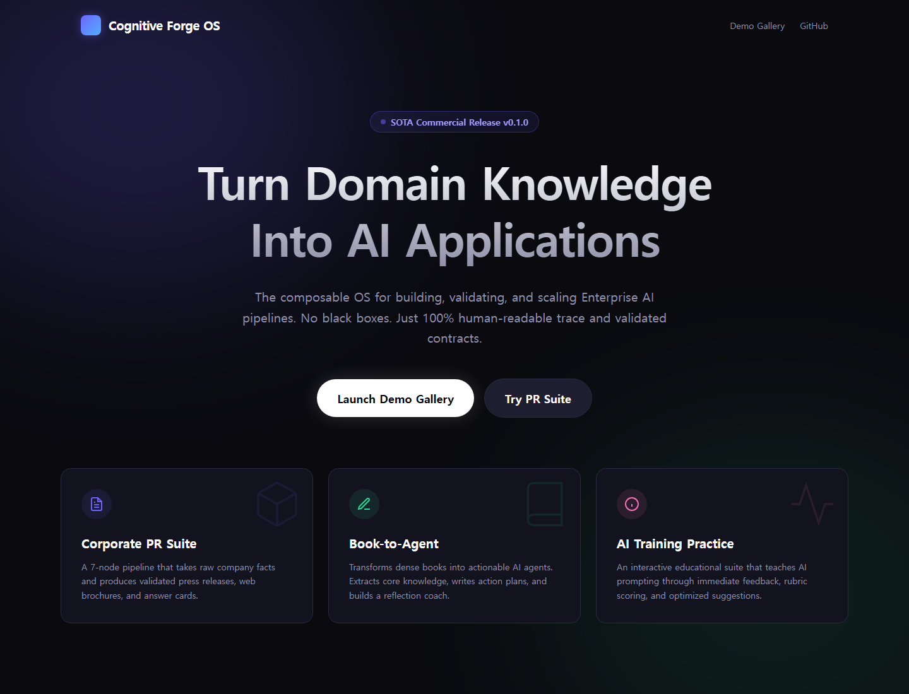
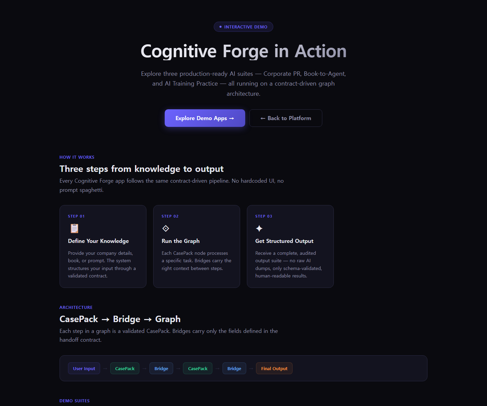
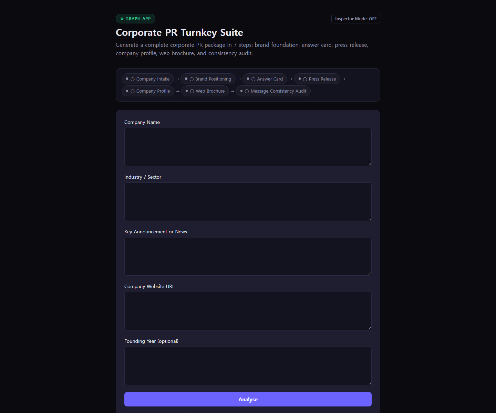
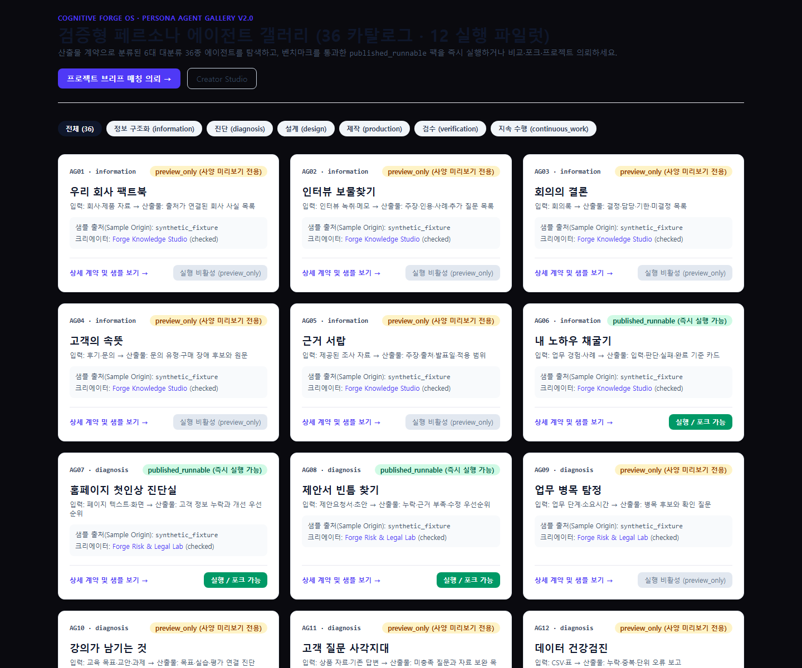
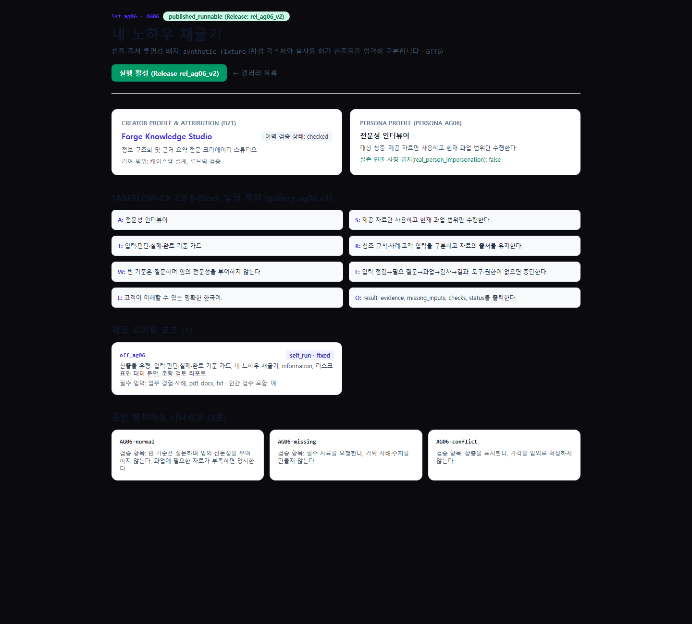
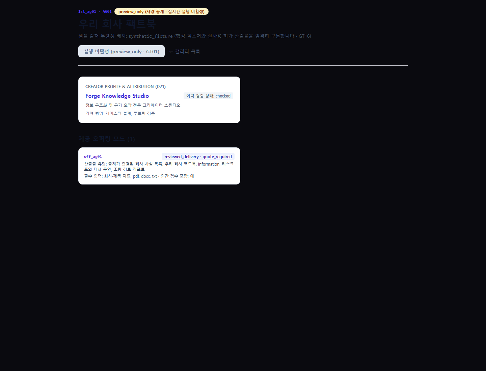
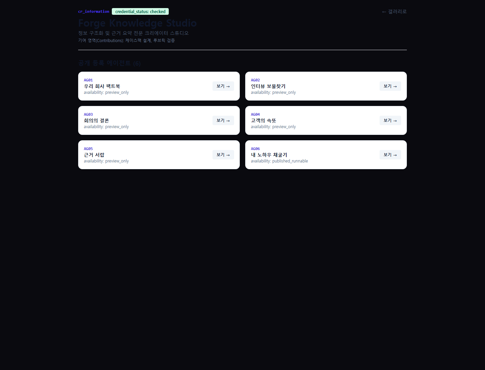
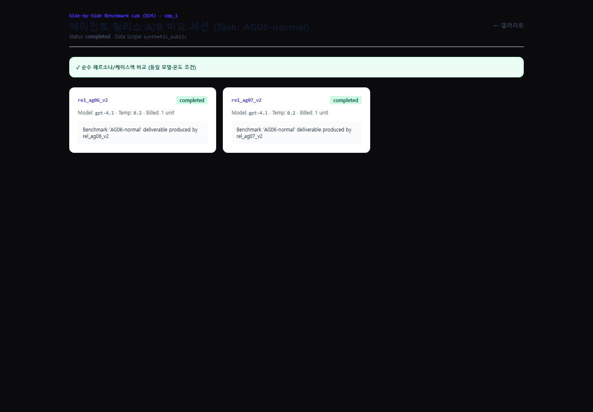
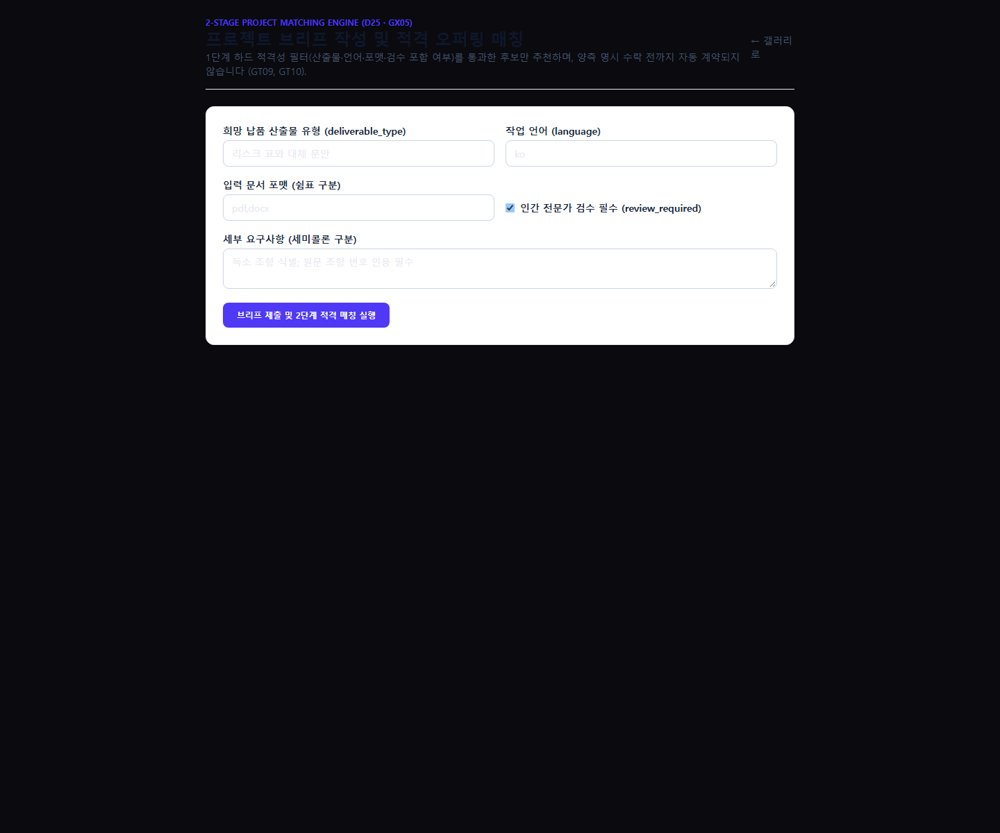

# 04. 사용자 가이드 (End-User, Creator & Enterprise Buyer Guide)

본 문서는 **Cognitive Forge OS**를 이용하는 **일반 사용자**, **에이전트 크리에이터**, **기업 바이어(프로젝트 의뢰자)**를 위한 단계별 화면 사용 가이드입니다.

---

## 1. 역할별 빠른 시작 (Quick Start by Role)

| 사용자 역할 | 주요 목적 | 권장 이동 경로 |
| :--- | :--- | :--- |
| **일반 사용자 (End-User)** | 검증된 에이전트를 즉시 실행하여 보도자료·계약 검토·도서 구조화 산출물 획득 | 홈(`/`) → 데모 허브(`/demo`) 또는 갤러리(`/gallery`) → `published_runnable` 에이전트 실행 |
| **기업 바이어 (Buyer)** | 우리 회사의 과제에 맞는 에이전트를 A/B 비교하거나 프로젝트 브리프로 최적 후보 추천받기 | 갤러리(`/gallery`) → A/B 비교 실험실(`/compare/cmp_1`) → 프로젝트 의뢰(`/projects/new`) |
| **크리에이터 (Creator)** | 기존 에이전트를 포크하여 커스터마이징하거나 새 `TASKFLOW-CX 2.0` 에이전트 제작·출시 | 갤러리 상세(`/gallery/lst_ag06`) → 포크 생성 → Studio(`/studio/apps`) 편집·벤치마크 검증 |

---

## 2. 메인 랜딩 및 v1 Public Demo Hub 사용법 (`/`, `/demo`)

### 2.1 메인 랜딩 페이지 (`/`)
프로덕션 URL(`https://cognitive-forge-two.vercel.app`)에 접속하면 Cognitive Forge OS의 핵심 가치 제안과 데모 허브/갤러리 진입 버튼을 확인할 수 있습니다.

### 2.2 Public Demo Hub 및 3대 도메인 스위트 실행 (`/demo`, `/a/[slug]`)
`/demo` 페이지에서는 3대 대표 도메인 스위트(**Corporate PR Suite**, **Book-to-Agent Suite**, **AI Utilization Training Suite**)와 15개 개별 CasePack을 즉시 체험할 수 있습니다.

1. **스위트 선택**: 예를 들어 **Corporate PR Suite**(`/a/corporate-pr-suite`)를 클릭합니다.
2. **입력 데이터 작성 또는 샘플 로드**: 기업명, 산업군, 핵심 제공 가치, 타깃 고객을 입력합니다.
3. **그래프 실행 및 신뢰 배지 확인**: 실행이 완료되면 보도자료·기업 프로필·웹 브로슈어·Q&A 카드와 함께 **검증 상태(`validation_status`)**, **완결성 점수(`completeness_score`)**, **출시 준비 여부(`is_export_ready`)** 배지를 확인합니다.

---

## 3. Gallery v2.0 에이전트 탐색 및 상세 확인 (`/gallery`, `/gallery/[slug]`)

### 3.1 36종 에이전트 카탈로그 및 6대 카테고리 탐색 (`/gallery`)
`/gallery` 페이지에서는 6대 1차 카테고리, 6종 멀티에이전트 추천 번들(`BD01`~`BD06`), 그리고 36종의 전체 에이전트 카탈로그를 탐색할 수 있습니다.

- **상단 필터 활용**:
  - **카테고리 필터**: `정보 정리·비교·요약`, `진단·검증·리스크 발견`, `기획·설계·전략화`, `제작·전환·패키징`, `코칭·학습·훈련`, `추천·매칭·개인화 보조` 중 원하는 도메인을 선택합니다.
  - **가용성 필터 (`availability`)**: 즉시 실행 가능한 12종만 보려면 `published_runnable`을, 향후 출시 예정인 사양 공개 에이전트 24종을 보려면 `preview_only`를 선택합니다.
  - **오퍼링 모드 필터 (`offering_mode`)**: `self_serve_run`(셀프 실행), `fork_customize`(포크 커스터마이징), `managed_delivery`(전문가 검수 납품), `enterprise_private`(사내 전용 구축) 기준으로 필터링할 수 있습니다.

### 3.2 실행 가능(`published_runnable`) 에이전트 상세 보기 (`/gallery/lst_ag06`)
예를 들어 **`AG06` (사내 암묵지 인터뷰 구조화 에이전트)** 카드를 클릭하면 `/gallery/lst_ag06` 상세 페이지로 이동합니다.

이 화면에서 사용자는 다음 정보를 투명하게 확인할 수 있습니다:
1. **샘플 출처 투명성 배지 (`sample_origin`)**: 표시된 샘플이 합성 벤치마크 픽스처(`synthetic_benchmark`)인지 실제 허가된 고객 사례인지 명확히 구분하여 표시합니다(`GT16`).
2. **크리에이터 및 페르소나 아트리뷰션**: 에이전트를 제작한 크리에이터(`Forge Knowledge Studio`)의 이력 검증 상태(`credential_status: checked`)와 실존 인물 사칭 금지(`real_person_impersonation: false`) 준수 여부를 확인합니다.
3. **`TASKFLOW-CX 2.0` 8-Block 실행 계약 및 공인 벤치마크 3종**: 에이전트의 입출력 계약과 검증 루브릭을 실행 전에 투명하게 검토할 수 있습니다.

### 3.3 사양 공개(`preview_only`) 에이전트 상세 보기 (`/gallery/lst_ag01`)
아직 벤치마크 적격성 인증 전인 24종의 `preview_only` 리스팅(예: `/gallery/lst_ag01`)에서는 에이전트 사양과 오퍼링 구성을 열람할 수 있으며, 실시간 실행 버튼은 안전하게 비활성화(`disabled`)되어 있습니다(`GT01`).

---

## 4. 크리에이터 프로필, A/B 비교 실험실 및 프로젝트 매칭

### 4.1 크리에이터 프로필 확인 (`/creators/[id]`)
리스팅 상세 화면에서 크리에이터 이름을 클릭하면 `/creators/cr_information` 프로필 페이지로 이동하여 해당 크리에이터의 소개, 검증 상태, 기여 범위 및 공개 리스팅 목록을 확인할 수 있습니다.

### 4.2 Side-by-Side 벤치마크 A/B 비교 실험실 (`/compare/[id]`)
동일한 업무 과제에 대해 서로 다른 에이전트 릴리스(2~3종)의 산출물 품질을 나란히 비교하려면 `/compare/cmp_1` 실험실을 이용합니다.

- **복합 설정 차이 자동 고지 (`GT07`)**: 비교 대상 릴리스 간에 기반 모델(`model_name`)이나 온도(`temperature`) 설정이 다르면 상단 배너에 경고 메시지가 표시되어 사용자가 왜곡 없이 비교 결과를 해석할 수 있도록 돕습니다.

### 4.3 기업 프로젝트 브리프 등록 및 2-Stage 매칭 (`/projects/new`)
자사 과제에 어떤 에이전트나 오퍼링이 적합한지 추천받으려면 `/projects/new` 페이지에서 프로젝트 요구사항을 조회합니다.

- **Stage 1 (하드 자격 필터)**: 필수 입력 문서 포맷(`pdf`, `docx`), 지원 언어(`ko`), 인간 검수 지원 여부를 기준으로 부적격 후보(`eligible: false`)와 미충족 사유(`unmet_conditions`)를 먼저 걸러냅니다(`GT09`).
- **Stage 2 (가중치 적합도 랭킹 및 사전 확인 항목 안내)**: 적격 후보 중 적합도 점수(`score`) 순으로 추천 목록을 제시하며, 실제 계약 전 반드시 확인해야 할 항목(`needs_confirmation`)을 함께 안내합니다(`GT10`).
