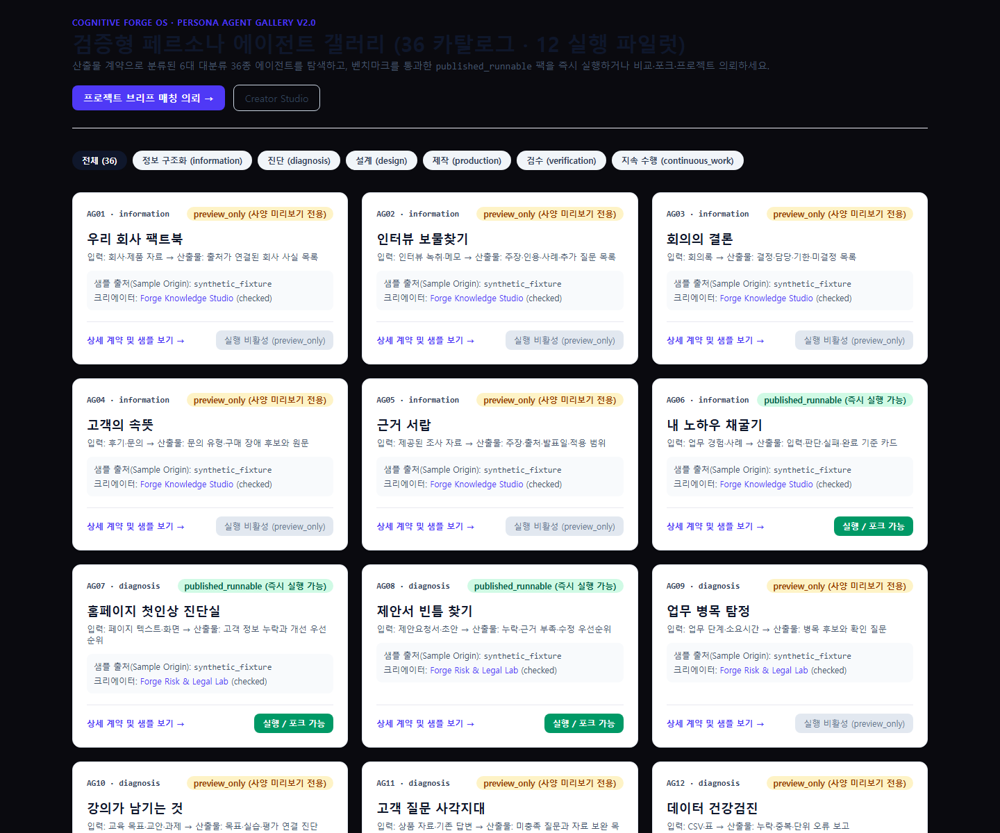
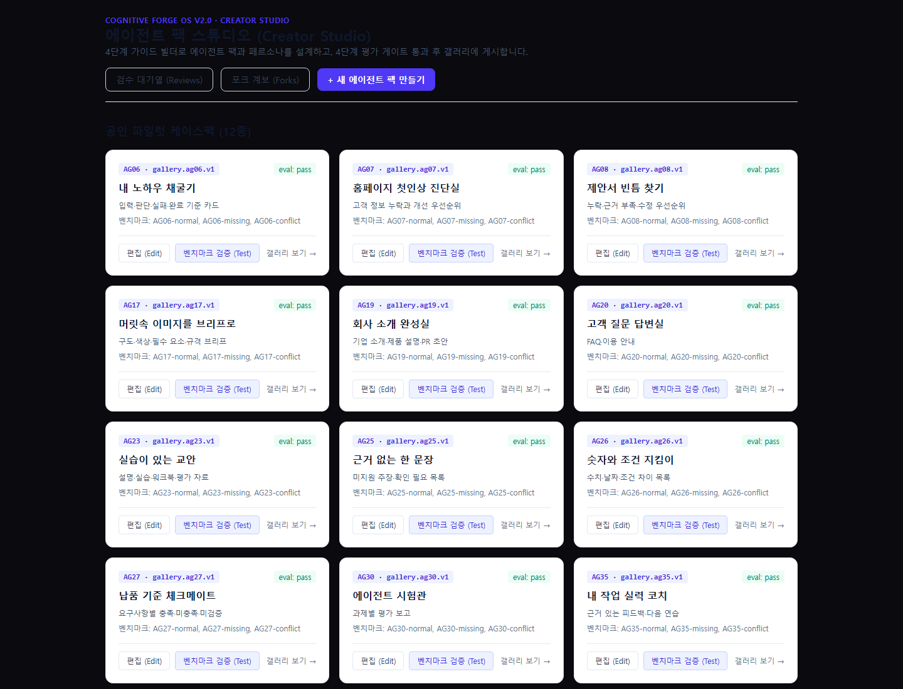

# Cognitive Forge OS (v1 Suites + v2.0 Core & Gallery Edition) — 공식 시스템 가이드 허브

**Cognitive Forge OS**는 비정형 도메인 지식·문서·인터뷰·정책을 **근거 고정(Evidence-Pinned) 및 인간 검수(Human-in-the-Loop)가 내장된 실행형 AI 에이전트 앱(`CasePack` / `ReleaseManifest`)**으로 컴파일·출시·비교·매칭·운영하는 **Knowledge-to-Agent Operating System**입니다.

본 디렉터리(`docs/guide/`)는 시스템의 **아키텍처**, **기능 명세**, **운영자 가이드**, **사용자 가이드** 및 **실제 프로덕션 화면 스크린 캡처(`docs/guide/screenshots/`)**를 통합 수록합니다.

---

## 1. 문서 구성 목록

| 문서 번호 | 문서 파일 | 대상 독자 | 핵심 수록 내용 |
| :---: | :--- | :--- | :--- |
| **01** | [01_SYSTEM_ARCHITECTURE.md](./01_SYSTEM_ARCHITECTURE.md) | 시스템 아키텍트, 백엔드/프론트엔드 엔지니어 | 8개 모노레포 패키지 계층 구조, Core v2.0 상태 머신, Gallery v2.0 3축 분리 아키텍처, 데이터/보안/RLS 경계, 런타임 파이프라인 및 Mermaid 다이어그램 |
| **02** | [02_FUNCTIONAL_SPECIFICATION.md](./02_FUNCTIONAL_SPECIFICATION.md) | 프로덕트 매니저, QA 엔지니어, API 연동 개발자 | v1 3대 도메인 스위트(15 CasePack + 11 Bridge), Core v2.0(`TASKFLOW-CX 2.0`, 근거 인용·팩트 충돌 감지, 인간 검수, 릴리스 적격성 게이트, Webhook), Gallery v2.0(36종 카탈로그, 12종 파일럿 팩, 포크, A/B 비교, 2-Stage 매칭) 및 OpenAPI `/api/v1/*` 15개 엔드포인트 전체 명세 |
| **03** | [03_OPERATOR_GUIDE.md](./03_OPERATOR_GUIDE.md) | 데브옵스(DevOps), 플랫폼 운영자, 보안 감사자 | 환경 설정, Supabase 마이그레이션(`00001`~`00013`), Vercel 배포, 상용 릴리스 게이트(`pnpm release:check`), Studio 운영 콘솔 매뉴얼, 리스팅 일시중지/보존 정책, 보안 No-Leak 스캔 및 트러블슈팅 |
| **04** | [04_USER_GUIDE.md](./04_USER_GUIDE.md) | 일반 사용자, 에이전트 크리에이터, 기업 바이어(의뢰자) | 역할별 빠른 시작(Quick Start), 데모 허브 및 3대 스위트 실행, Gallery 36종 탐색 및 실행/포크, 벤치마크 A/B 비교 실험, 프로젝트 브리프 등록 및 2-Stage 매칭, Studio 제작·평가·검수 워크플로 (전 화면 스크린 캡처 수록) |

---

## 2. 스크린 캡처 카탈로그 (`docs/guide/screenshots/`)

프로덕션 배포 환경(`https://cognitive-forge-two.vercel.app`)에서 캡처된 16종의 실제 UI 화면 이미지입니다.

| 번호 | 파일명 | 대응 라우트 | 화면 설명 |
| :---: | :--- | :--- | :--- |
| 01 | [`01-home-landing.png`](./screenshots/01-home-landing.png) | `/` | 메인 랜딩 페이지 및 진입 허브 |
| 02 | [`02-demo-hub.png`](./screenshots/02-demo-hub.png) | `/demo` | v1 Public Demo Hub (3대 대표 스위트 & CasePack 갤러리) |
| 03 | [`03-suite-corporate-pr.png`](./screenshots/03-suite-corporate-pr.png) | `/a/corporate-pr-suite` | Corporate PR Suite 6-Node 그래프 실행 및 산출물 패키지 화면 |
| 04 | [`04-gallery-explorer.png`](./screenshots/04-gallery-explorer.png) | `/gallery` | Gallery v2.0 에이전트 탐색기 (36종 카탈로그·6대 카테고리·6종 번들) |
| 05 | [`05-gallery-runnable-ag06.png`](./screenshots/05-gallery-runnable-ag06.png) | `/gallery/lst_ag06` | `published_runnable` 파일럿 팩 상세 (`AG06` 사내 암묵지 인터뷰 구조화 에이전트) |
| 06 | [`06-gallery-preview-ag01.png`](./screenshots/06-gallery-preview-ag01.png) | `/gallery/lst_ag01` | `preview_only` 에이전트 리스팅 상세 (`AG01` 실행 버튼 비활성 및 사양 공개) |
| 07 | [`07-creator-profile.png`](./screenshots/07-creator-profile.png) | `/creators/cr_information` | 크리에이터 프로필 및 아트리뷰션 (`Forge Knowledge Studio`) |
| 08 | [`08-benchmark-compare.png`](./screenshots/08-benchmark-compare.png) | `/compare/cmp_1` | Side-by-Side 벤치마크 A/B 비교 실험실 (설정 차이 경고 배너 포함) |
| 09 | [`09-project-brief-matching.png`](./screenshots/09-project-brief-matching.png) | `/projects/new` | 기업 프로젝트 브리프 등록 및 2-Stage 매칭 추천 화면 |
| 10 | [`10-studio-apps-list.png`](./screenshots/10-studio-apps-list.png) | `/studio/apps` | Studio 에이전트 애플리케이션 목록 및 릴리스 상태 콘솔 |
| 11 | [`11-studio-app-new.png`](./screenshots/11-studio-app-new.png) | `/studio/apps/new` | Studio 신규 에이전트 앱 생성 화면 |
| 12 | [`12-studio-app-edit.png`](./screenshots/12-studio-app-edit.png) | `/studio/apps/AG06/edit` | Studio `TASKFLOW-CX 2.0` 8-Block 계약 편집기 |
| 13 | [`13-studio-app-test.png`](./screenshots/13-studio-app-test.png) | `/studio/apps/AG06/test` | Studio 벤치마크 평가 실행 및 릴리스 적격성(`Release Qualification`) 게이트 |
| 14 | [`14-studio-review-queue.png`](./screenshots/14-studio-review-queue.png) | `/studio/reviews` | Studio 인간 검수 대기열 (`waiting_review` 승인/수정요청/반려) |
| 15 | [`15-studio-run-detail.png`](./screenshots/15-studio-run-detail.png) | `/studio/runs/run_1` | Studio 실행 영수증(`RunReceipt`) 및 산출물 버전·인용 감사 이력 |
| 16 | [`16-studio-forks-lineage.png`](./screenshots/16-studio-forks-lineage.png) | `/studio/forks` | Studio 포크 계보(`ForkLineage`) 및 격리 거버넌스 대시보드 |

---

## 3. 대표 프리뷰 화면

### Gallery v2.0 에이전트 탐색기 (`/gallery`)

### Studio 에이전트 애플리케이션 콘솔 (`/studio/apps`)

